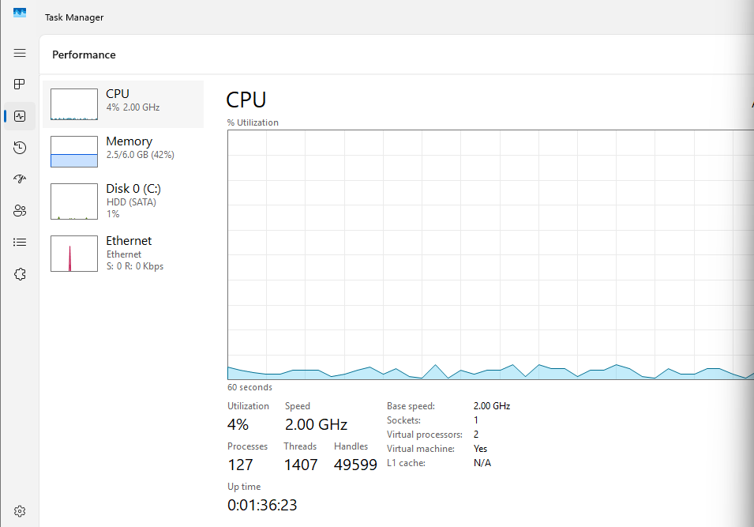
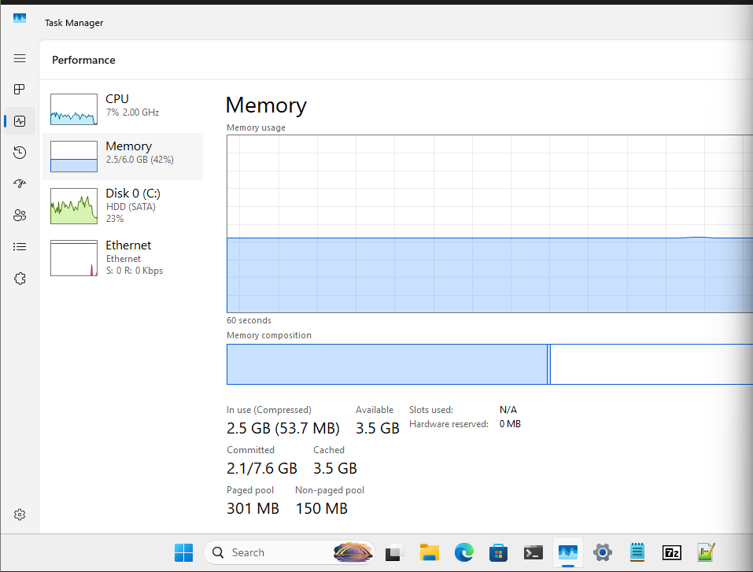
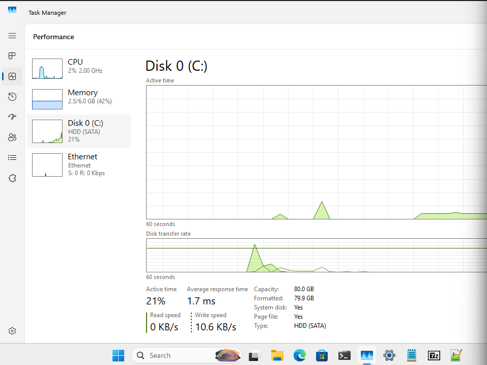
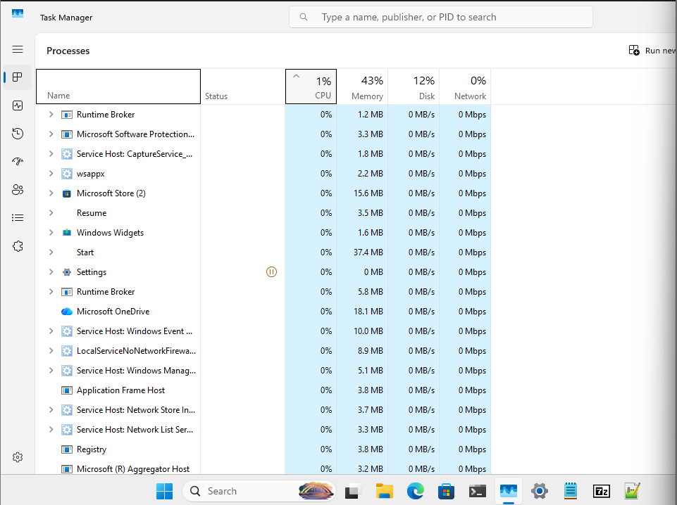
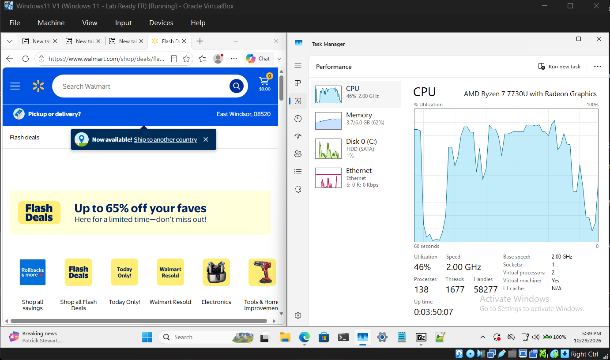
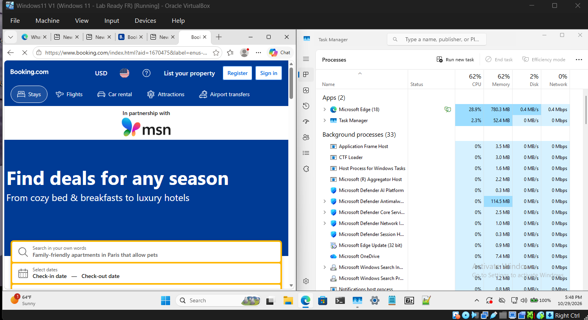
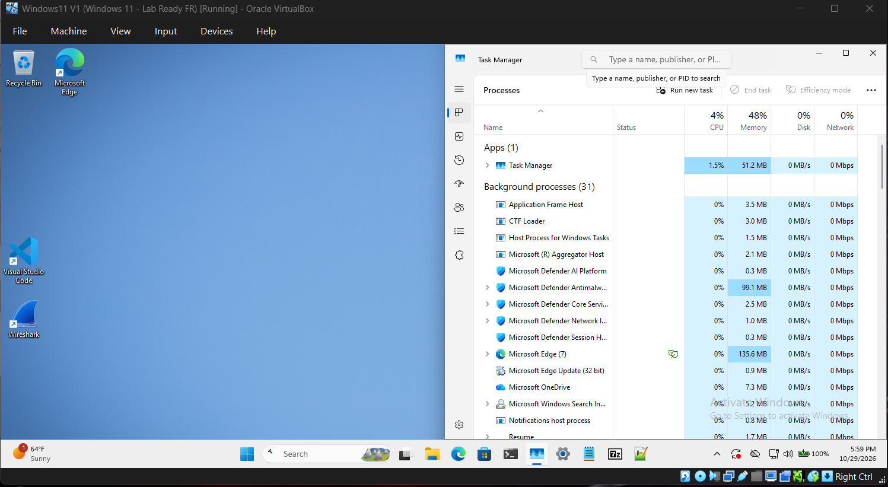

# Windows 11 Performance Troubleshooting Lab

**IT Support | Windows 11 | System Diagnostics | Performance Monitoring | Troubleshooting**

## Project Overview

This project demonstrates practical Windows 11 performance troubleshooting techniques relevant to entry-level IT Support and Help Desk environments.

Using a Windows 11 virtual machine configured in Oracle VirtualBox, I conducted a structured investigation of system performance by examining CPU utilization, memory consumption, disk activity, and running processes.

The lab involved establishing baseline performance measurements, simulating a system slowdown through increased browser activity, identifying resource-intensive processes, implementing corrective action, and verifying improved system performance.

The objective was to develop hands-on experience with Windows diagnostic utilities and demonstrate a systematic approach to identifying and resolving common end-user performance issues.

---

## Project Objectives

* Establish baseline CPU, memory, disk, and process utilization measurements.
* Simulate a realistic Windows 11 performance issue.
* Investigate elevated system resource consumption using Windows Task Manager.
* Identify applications contributing to reduced system responsiveness.
* Implement appropriate corrective action without restarting Windows.
* Verify performance improvements through before-and-after measurements.
* Document troubleshooting procedures, technical findings, and supporting evidence.

---

## Lab Environment

| Component                       | Configuration                            |
| ------------------------------- | ---------------------------------------- |
| Operating System                | Windows 11                               |
| Virtualization Platform         | Oracle VirtualBox                        |
| Environment                     | Windows 11 Virtual Machine               |
| Allocated Memory                | 6 GB RAM                                 |
| Virtual Processors              | 2                                        |
| Virtual Disk                    | 80 GB                                    |
| Primary Diagnostic Tool         | Windows Task Manager                     |
| Application Used for Simulation | Microsoft Edge                           |
| Monitoring Categories           | CPU, Memory, Disk, Processes             |
| Documentation                   | Performance Measurements and Screenshots |

---

## Troubleshooting Scenario

### Reported Issue

A simulated end user reports that their Windows 11 computer becomes noticeably slower when multiple browser tabs are open.

The user experiences reduced system responsiveness during normal browsing activities.

### Troubleshooting Objective

Determine whether increased system resource utilization is contributing to the slowdown, identify the applications responsible, implement corrective action, and verify that performance returns to normal.

---

## System Performance Analysis

### 1. CPU Performance Monitoring

**Tool:** Windows Task Manager — Performance Tab

Accessed Windows Task Manager to examine CPU utilization and establish a baseline measurement under normal operating conditions.

**Technical Observations:**

* CPU utilization remained approximately 1–4% during idle conditions.
* Reviewed processor activity through real-time performance monitoring.
* Observed no sustained CPU utilization spikes during baseline monitoring.
* Established a reference measurement for identifying abnormal processor activity.

**Screenshot — CPU Baseline**

---

### 2. Memory Utilization Analysis

**Tool:** Windows Task Manager — Memory Performance Tab

Examined system memory utilization to understand how Windows allocates available RAM to operating system services, background processes, and applications.

**Technical Observations:**

* Baseline memory utilization was approximately 42%.
* Approximately 2.5 GB of the virtual machine's 6 GB RAM allocation was in use.
* Reviewed available and actively utilized system memory.
* Documented baseline memory utilization for comparison during the simulated performance issue.

**Screenshot — Memory Baseline**

---

### 3. Disk Performance Monitoring

**Tool:** Windows Task Manager — Disk Performance Tab

Monitored storage activity to examine disk utilization and understand its relationship to overall operating system responsiveness.

**Technical Observations:**

* Reviewed disk activity under normal operating conditions.
* Examined disk active time and response time through Windows performance metrics.
* Observed no evidence of sustained disk saturation during baseline monitoring.
* Established a reference for evaluating whether disk activity contributed to the simulated slowdown.

**Screenshot — Disk Baseline**

---

### 4. Running Processes and Resource Consumption

**Tool:** Windows Task Manager — Processes Tab

Investigated active applications and background processes to understand how individual processes contribute to overall system resource utilization.

**Technical Observations:**

* Identified active applications and background processes.
* Examined CPU and memory consumption across running processes.
* Reviewed resource utilization under normal operating conditions.
* Established a baseline for identifying resource-intensive applications during troubleshooting.

**Screenshot — Processes Baseline**

---

## Performance Issue Simulation

### 5. Reproducing the System Slowdown

**Tools:** Microsoft Edge and Windows Task Manager

To reproduce a realistic end-user performance issue, I opened multiple Microsoft Edge browser tabs and navigated between websites.

I monitored system resource utilization while performing browsing activities to determine how the increased workload affected performance.

**Technical Observations:**

* CPU utilization increased significantly compared with baseline measurements.
* CPU usage reached approximately 80% at its highest observed point.
* The captured performance screenshot showed CPU utilization at 46%.
* Memory utilization increased to approximately 62%.
* The virtual machine became noticeably slower and less responsive.

These observations demonstrated a relationship between increased browser activity, elevated resource consumption, and reduced system responsiveness.

**Screenshot — CPU Under Load**

---

## Troubleshooting and Diagnosis

### 6. Identifying the Resource-Intensive Application

**Tool:** Windows Task Manager — Processes Tab

After reproducing the slowdown, I examined running processes to determine which applications were consuming the most system resources.

I reviewed CPU and memory utilization at the process level to identify potential contributors to the performance issue.

### Diagnostic Findings

| Performance Metric                        | Observation    |
| ----------------------------------------- | -------------- |
| Total CPU Utilization                     | 62%            |
| Total Memory Utilization                  | 62%            |
| Highest Visible CPU-Consuming Application | Microsoft Edge |
| Microsoft Edge CPU Utilization            | 28.9%          |
| Microsoft Edge Memory Consumption         | 780.3 MB       |
| Microsoft Edge Process Count              | 18             |

### Technical Analysis

Microsoft Edge was identified as the largest visible CPU-consuming application in the captured Task Manager results.

The browser was also consuming approximately 780 MB of system memory.

Given the virtual machine's allocation of two virtual processors and 6 GB RAM, the increased browser workload represented a significant demand on available system resources.

The findings indicated that Microsoft Edge activity was a major contributor to the observed performance degradation.

However, the evidence did not establish CPU utilization as the sole cause of the slowdown.

**Screenshot — High CPU Processes**

---

## Resolution and Performance Verification

### 7. Implementing Corrective Action

After identifying Microsoft Edge as a significant contributor to elevated CPU and memory utilization, I reduced the browser workload by closing unnecessary browser tabs.

**Corrective Actions:**

1. Identified Microsoft Edge as a resource-intensive application.
2. Closed unnecessary browser tabs to reduce active browsing workloads.
3. Allowed system resource utilization to stabilize.
4. Reopened Windows Task Manager to monitor CPU and memory consumption.
5. Evaluated overall system responsiveness following the corrective action.

The performance issue was addressed without restarting the Windows operating system.

### Before-and-After Performance Comparison

| Performance Metric                | During Issue      | After Resolution |
| --------------------------------- | ----------------- | ---------------- |
| Total CPU Utilization             | 62%               | 4%               |
| Total Memory Utilization          | 62%               | 48%              |
| Microsoft Edge CPU Usage          | 28.9%             | 0%               |
| Microsoft Edge Memory Consumption | 780.3 MB          | 135.6 MB         |
| Disk Utilization                  | 2%                | 0%               |
| System Responsiveness             | Noticeably Slower | Improved         |

### Verification Results

Following the corrective action, total CPU utilization decreased from 62% to approximately 4%.

Memory utilization decreased from 62% to 48%, while Microsoft Edge's memory consumption fell from approximately 780 MB to 136 MB.

Microsoft Edge's CPU utilization also decreased to 0% at the time of verification.

The virtual machine became noticeably smoother and more responsive.

These results demonstrated that reducing unnecessary browser activity successfully addressed the simulated performance issue.

**Screenshot — CPU After Fix**

---

## Root Cause Analysis

**Identified Contributing Factor:** Increased CPU and memory consumption associated with multiple active Microsoft Edge browser tabs.

**Observed Impact:** Elevated resource utilization accompanied by reduced system responsiveness.

**Corrective Action:** Reduced the active browser workload by closing unnecessary tabs.

**Verified Outcome:** CPU and memory utilization decreased significantly, and normal system responsiveness returned.

The troubleshooting evidence supports excessive browser activity as a significant contributor to the slowdown, although other resource demands may also have influenced performance.

---

## Findings and Results

The investigation demonstrated how changes in application activity can affect Windows 11 system performance.

**Key Findings:**

* **CPU Performance:** Utilization increased from approximately 1–4% during baseline monitoring to a reported peak of approximately 80% during the simulated workload.
* **Memory Management:** RAM utilization increased from approximately 42% to 62% during browser activity.
* **Process Monitoring:** Microsoft Edge was identified as the highest visible CPU-consuming application during diagnosis.
* **Corrective Action:** Reducing unnecessary browser activity decreased resource consumption.
* **Resolution Verification:** CPU utilization returned to approximately 4%, memory utilization decreased to 48%, and system responsiveness improved.

The results reinforced the importance of establishing baseline measurements, identifying resource-intensive applications, implementing targeted corrective actions, and verifying performance improvements.

---

## Technical Skills Demonstrated

| Skill                     | Practical Application                                                        |
| ------------------------- | ---------------------------------------------------------------------------- |
| Windows 11 Administration | Navigated built-in operating system diagnostic utilities                     |
| Performance Monitoring    | Analyzed CPU, memory, and disk utilization                                   |
| Process Analysis          | Identified applications consuming significant system resources               |
| System Diagnostics        | Investigated performance indicators associated with system slowdowns         |
| Troubleshooting           | Reproduced, investigated, and resolved a simulated performance issue         |
| Root Cause Analysis       | Identified browser activity as a significant contributing factor             |
| Resolution Verification   | Compared performance measurements before and after corrective action         |
| Virtualization            | Conducted troubleshooting within an isolated Windows 11 virtual machine      |
| Technical Documentation   | Recorded diagnostic findings, corrective actions, and supporting screenshots |

---

## Conclusion

This project provided hands-on experience investigating and resolving a simulated Windows 11 performance issue in a virtualized environment.

By establishing baseline performance measurements, reproducing a system slowdown, analyzing resource-intensive processes, implementing corrective action, and verifying improved performance, I applied a structured troubleshooting methodology relevant to entry-level IT Support and Help Desk environments.

The investigation demonstrated how increased browser activity can contribute to elevated CPU and memory utilization and how targeted corrective actions can restore system responsiveness.

The lab strengthened my practical understanding of Windows performance monitoring, process analysis, system diagnostics, and technical documentation.

---

**Author:** Jarrett Justice
**Technical Focus:** IT Support | Windows 11 | System Troubleshooting | CompTIA A+
